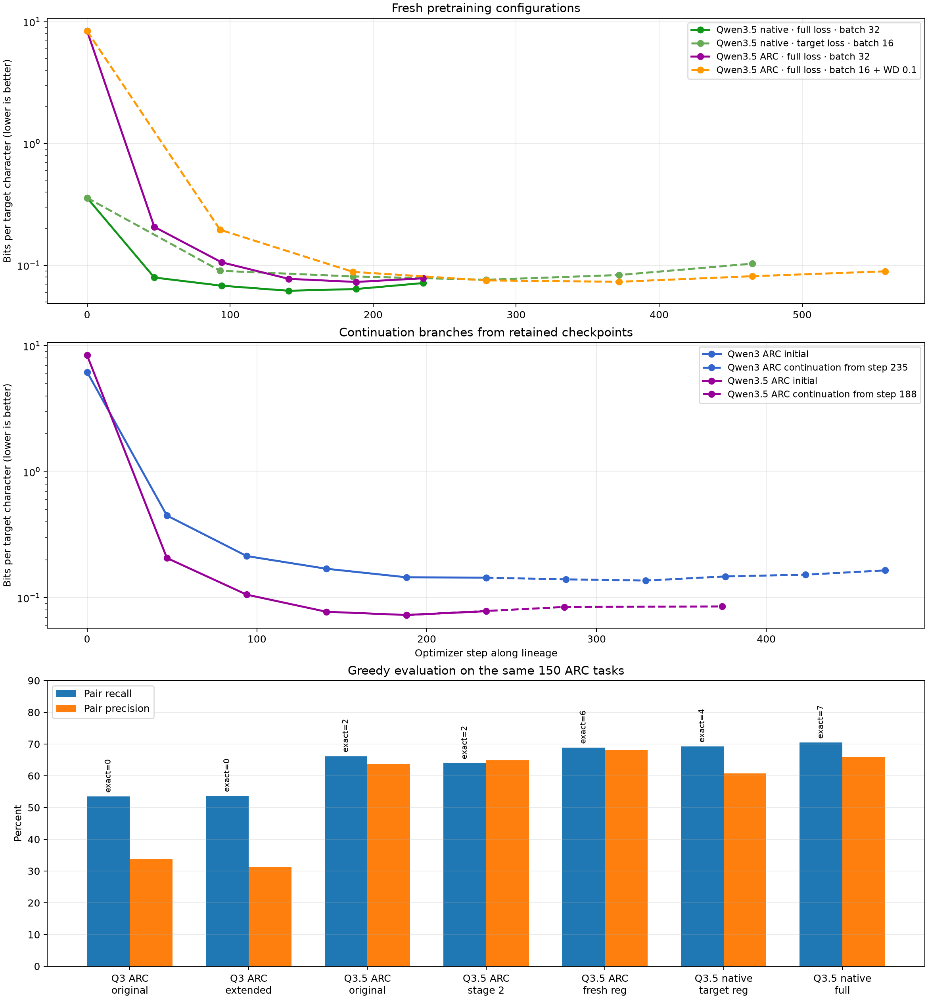

# Seguimiento ARC: Qwen3.5 con tokenizer propio y búsqueda de regularización

Fecha: 12 de septiembre de 2026  
Hardware: 1 × NVIDIA A100-SXM4-80GB



## Conclusión

El mejor resultado global sigue siendo **Qwen3.5-0.8B nativo con full loss,
batch efectivo 32, época 3 / optimizer step 141**. Obtuvo 7/150 exactos,
70.48% de pair recall y 0.06186 bits por carácter objetivo.

La mejor configuración con tokenizer ARC es ahora **Qwen3.5-0.8B custom
entrenado desde el modelo base con full loss, batch efectivo 16, `lr=1.5e-5`
y weight decay 0.1, época 4 / step 372**. Subió de 2 a 6 exactos respecto al
primer custom y mejoró recall, precisión y terminación. No supera todavía al
nativo en exactos/recall/BPC, pero queda cerca y es directamente compatible
con el entorno RL actual de vocabulario 24.

Checkpoints conservados:

```text
# Mejor global
checkpoints/compare_qwen35_pretrained_native_v3/

# Mejor con tokenizer ARC
checkpoints/optimize_qwen35_custom_fresh_full_reg_v2.safetensors
```

## Protocolo común

- 1.476 ejemplos de entrenamiento: original, rotaciones 90/180/270 y dos
  cambios de color independientes, con filtrado a longitud ARC 2.816.
- Las mismas 150 tareas held-out en todos los experimentos, sin rotaciones ni
  cambios de color.
- Seed 3407, BF16 de cómputo, AdamW fused y gradient clipping a 1.0.
- Train loss `full` incluye prompt y target; `target` solo optimiza la salida.
- Eval NLL se calcula únicamente sobre el target dorado.
- Para comparar tokenizers se usa BPC: NLL acumulada dividida entre caracteres
  objetivo y `ln(2)`. En el tokenizer ARC, un token es un carácter.
- Selección de checkpoint por eval NLL; la decisión para RL añade exactos,
  pair recall, pair precision y longitud greedy.

Qwen3.5 custom usa `Qwen3_5ForCausalLM`, conserva los 498.137.920 parámetros
del cuerpo textual preentrenado y sustituye únicamente embedding/LM head por
las 24 fichas ARC. Ambas matrices permanecen atadas, como en Qwen3.5-0.8B.
No se incluye el encoder visual porque estos experimentos solo consumen texto.

## Resultados generativos finales

| Modelo/configuración | NLL | BPC | Exactos | Recall | Precisión | Long. media | Máxima |
|---|---:|---:|---:|---:|---:|---:|---:|
| Qwen3+ARC original | 0.099959 | 0.144210 | 0/150 | 53.47% | 33.92% | 839.1 | 2816 |
| Qwen3+ARC continuado | 0.094705 | 0.136630 | 0/150 | 53.69% | 31.24% | 868.1 | 2816 |
| Qwen3.5+ARC original | 0.050528 | 0.072897 | 2/150 | 66.18% | 63.57% | 469.4 | 2816 |
| Qwen3.5+ARC stage 2 | 0.059137 | 0.085317 | 2/150 | 63.99% | 64.88% | 436.8 | 2816 |
| **Qwen3.5+ARC fresh regularizado** | 0.050724 | 0.073179 | **6/150** | **68.85%** | **68.16%** | **424.8** | **1342** |
| Qwen3.5 nativo target-only | 0.052657 | 0.075968 | 4/150 | 69.30% | 60.78% | 486.4 | 2228 |
| **Qwen3.5 nativo full** | **0.042877** | **0.061858** | **7/150** | **70.48%** | 66.03% | 453.3 | 2228 |

El custom regularizado no reduce la NLL frente al custom original: queda
0.39% peor. Sin embargo, la evaluación greedy mejora de 2 a 6 exactos, suma
275 pares objetivo cubiertos, aumenta precisión 4.59 puntos y deja de alcanzar
el máximo de 2.816 tokens. Para RL, esa mejora generativa importa más que la
diferencia mínima de teacher forcing.

Coste de las nuevas fases (solo entrenamiento, sin rollout final):

| Corrida | Épocas ejecutadas | Tiempo | Pico VRAM |
|---|---:|---:|---:|
| Qwen3.5+ARC original | 5 | 21.75 min | 13.89 GiB |
| Qwen3+ARC continuación | 5 | 17.81 min | 39.85 GiB |
| Qwen3.5 nativo target-only | 5 | 26.66 min | 61.25 GiB |
| Qwen3.5+ARC continuación regularizada | 2 | 8.55 min | 13.54 GiB |
| Qwen3.5+ARC fresh regularizado | 6 | 25.60 min | 13.54 GiB |

## Qwen3+ARC: ¿seguía mejorando?

Sí, pero solo durante dos épocas adicionales. Se retomó su checkpoint original
con `lr=1e-5`, warmup 5%, batch efectivo 32 y paciencia 3:

| Época de rama | Step local | Eval NLL | Train loss |
|---:|---:|---:|---:|
| baseline | 0 | 0.099959 | — |
| 1 | 47 | 0.097090 | 0.131766 |
| **2** | **94** | **0.094911** | 0.120034 |
| 3 | 141 | 0.102424 | 0.108521 |
| 4 | 188 | 0.105741 | 0.097399 |
| 5 | 235 | 0.114295 | 0.086539 |

La recarga BF16 del mejor checkpoint dio NLL 0.094705. Pair recall solo subió
de 53.47% a 53.69%, mientras precisión bajó de 33.92% a 31.24% y la longitud
media aumentó 29 tokens. La continuación mejora calibración teacher-forced,
pero no produce una mejora práctica de política para RL.

## Decisiones tomadas a partir de las trazas

### 1. Qwen3.5 nativo: ablación target-only

La corrida nativa original alcanzó el mínimo en época 3 y luego mostró la
señal clásica de sobreajuste: train loss `0.09697 → 0.05709`, mientras eval BPC
empeoró `0.06180 → 0.07151`. Se probó una configuración más regularizada:

- batch efectivo `32 → 16`;
- LR `3e-5 → 1.5e-5`;
- weight decay `0.01 → 0.1`;
- objetivo `full → target`;
- early stopping con paciencia 2 y mejora mínima 0.00025.

| Época | Step | Target train loss | Eval NLL | Eval BPC |
|---:|---:|---:|---:|---:|
| 1 | 93 | 0.076980 | 0.062497 | 0.090164 |
| 2 | 186 | 0.034298 | 0.056183 | 0.081055 |
| **3** | **279** | **0.020127** | **0.052741** | **0.076089** |
| 4 | 372 | 0.010346 | 0.057701 | 0.083245 |
| 5 | 465 | 0.004032 | 0.071519 | 0.103180 |

La reducción de batch y el weight decay no compensaron eliminar la pérdida
sobre prompt. La target train loss cayó casi a cero y el gap de generalización
se amplió. El rollout final también fue peor: 4 exactos y 69.30% recall. Por
tanto, el mejor setting nativo conocido sigue siendo full loss, batch 32,
`lr=3e-5`, weight decay 0.01 y parada en época 3.

### 2. Qwen3.5 custom: continuación regularizada

El custom original bajó eval NLL durante cuatro épocas
(`0.14336 → 0.07340 → 0.05367 → 0.05061`) y rebotó en la quinta (`0.05423`).
Primero se intentó continuar su época 4 con full loss, batch 16, `lr=5e-6` y
weight decay 0.1. Empeoró inmediatamente:

| Época de rama | Eval NLL | Train loss |
|---:|---:|---:|
| baseline | 0.050524 | — |
| 1 | 0.058560 | 0.084983 |
| 2 | 0.059179 | 0.070775 |

El rollout del último candidato mantuvo 2 exactos pero redujo recall a 63.99%.
La conclusión es que la época 4 ya está en el borde de sobreajuste; cambiar
regularización después no recupera generalización.

### 3. Qwen3.5 custom: entrenamiento fresh regularizado

Se aplicaron los mismos principios desde el modelo base, conservando full loss:

- batch efectivo `32 → 16` (`microbatch=8`, acumulación=2);
- LR `3e-5 → 1.5e-5`, escalado aproximadamente con el batch;
- weight decay `0.01 → 0.1`;
- seis épocas máximas y early stopping con paciencia 2.

| Época | Step | Train loss | Eval NLL | BPC |
|---:|---:|---:|---:|---:|
| 1 | 93 | 1.131308 | 0.135731 | 0.195816 |
| 2 | 186 | 0.153607 | 0.061238 | 0.088349 |
| 3 | 279 | 0.118776 | 0.052112 | 0.075182 |
| **4** | **372** | **0.094570** | **0.050777** | **0.073256** |
| 5 | 465 | 0.072067 | 0.056398 | 0.081364 |
| 6 | 558 | 0.055933 | 0.061881 | 0.089276 |

El mínimo teacher-forced empata prácticamente con el custom original, pero la
política greedy es mucho mejor. El batch pequeño desde el inicio parece ayudar
a aprender una política menos propensa a repeticiones y secuencias máximas.
El weight decay por sí solo no evita el rebote: época 4 sigue siendo el punto
correcto de parada.

## Recomendación para RL

1. Si se prioriza máximo rendimiento previo a RL, usar Qwen3.5 nativo full-loss
   de época 3: conserva la ventaja en exactos, recall y BPC.
2. Si se prioriza integración inmediata y espacio de acciones ARC compacto,
   usar Qwen3.5 custom fresh regularizado de época 4. Queda a solo un exacto y
   1.63 puntos de recall del nativo, con mayor precisión y menor longitud.
3. No continuar ninguno de los checkpoints ya convergidos con SFT convencional:
   las tres ramas de continuación muestran sobreajuste.
4. No usar target-only puro. Si se explora otra variante, el siguiente cambio
   razonable sería una mezcla ponderada prompt/target o dropout estructural,
   no más épocas ni una LR reiniciada.
5. Reservar un conjunto final diferente antes de decidir resultados de RL: las
   150 tareas actuales ya se han usado repetidamente para seleccionar épocas e
   hiperparámetros.

## Comandos reproducibles

Qwen3.5 con tokenizer ARC, comparación inicial:

```bash
.venv/bin/arc-pretrain-qwen35-custom \
  --epochs 5 --batch-size 8 --minibatches 4 \
  --gradient-checkpointing --no-compile \
  --eval-examples 150 --num-color-swaps 2 \
  --skip-baseline-greedy-eval \
  --run-name compare_qwen35_pretrained_custom \
  --log-file logs/compare_qwen35_pretrained_custom.jsonl \
  --output-checkpoint checkpoints/compare_qwen35_pretrained_custom.safetensors
```

Continuación Qwen3+ARC:

```bash
.venv/bin/arc-pretrain-qwen3 \
  --resume-checkpoint checkpoints/compare_qwen3_pretrained_custom_v2.safetensors \
  --epochs 8 --batch-size 8 --minibatches 4 \
  --learning-rate 1e-5 --warmup-fraction 0.05 \
  --early-stop-patience 3 --min-eval-improvement 0.00025 \
  --eval-examples 150 --num-color-swaps 2 \
  --skip-baseline-greedy-eval \
  --run-name extend_qwen3_pretrained_custom_to_plateau \
  --log-file logs/extend_qwen3_pretrained_custom_to_plateau.jsonl \
  --output-checkpoint checkpoints/extend_qwen3_pretrained_custom_to_plateau.safetensors
```

Ablación regularizada del nativo:

```bash
.venv/bin/arc-pretrain-qwen35-native \
  --epochs 6 --batch-size 4 --minibatches 4 \
  --gradient-checkpointing --loss-scope target \
  --learning-rate 1.5e-5 --weight-decay 0.1 \
  --early-stop-patience 2 --min-eval-improvement 0.00025 \
  --eval-examples 150 --num-color-swaps 2 \
  --skip-baseline-greedy-eval \
  --run-name optimized_qwen35_native_target_reg \
  --log-file logs/optimized_qwen35_native_target_reg.jsonl \
  --output-checkpoint checkpoints/optimized_qwen35_native_target_reg
```

Mejor configuración con tokenizer ARC:

```bash
.venv/bin/arc-pretrain-qwen35-custom \
  --epochs 6 --batch-size 8 --minibatches 2 \
  --gradient-checkpointing --no-compile --loss-scope full \
  --learning-rate 1.5e-5 --weight-decay 0.1 --warmup-fraction 0.1 \
  --early-stop-patience 2 --min-eval-improvement 0.0002 \
  --eval-examples 150 --num-color-swaps 2 \
  --skip-baseline-greedy-eval \
  --run-name optimize_qwen35_custom_fresh_full_reg_v2 \
  --log-file logs/optimize_qwen35_custom_fresh_full_reg_v2.jsonl \
  --output-checkpoint checkpoints/optimize_qwen35_custom_fresh_full_reg_v2.safetensors
```

## Artefactos y notas operativas

- Runner Qwen3.5 custom: `arc-pretrain-qwen35-custom`.
- Runner Qwen3/Qwen3.5 compartido: `arc-pretrain-qwen3`, ahora con
  gradient accumulation, gradient checkpointing opcional, ejecución sin
  compile y early stopping.
- Gráfica reproducible: `scripts/plotting/plot_pretraining_followup.py`.
- Logs completos: `logs/compare_qwen35_pretrained_custom.jsonl`,
  `logs/extend_qwen3_pretrained_custom_to_plateau.jsonl`,
  `logs/optimized_qwen35_native_target_reg.jsonl`,
  `logs/optimize_qwen35_custom_stage2_full_reg.jsonl` y
  `logs/optimize_qwen35_custom_fresh_full_reg_v2.jsonl`.
- W&B: runs `aftezact`, `fschuri0`, `ktd1z355`, `4vuif2xu` y `3eb8wiar` en el
  proyecto `ARC-Pretraining`.

La cuota de disco se alcanzó durante un intento intermedio. Se eliminaron los
checkpoints de dos ablaciones perdedoras y el archivo parcial, conservando sus
logs/W&B. Los checkpoints ganadores, el scratch comparativo y la continuación
Qwen3 permanecen disponibles. El campo `step=558` del evento `final` de la
continuación custom fallida es solo un error de metadatos antiguo: correspondía
a época local 2 / step 186. El contador quedó corregido en el runner.
