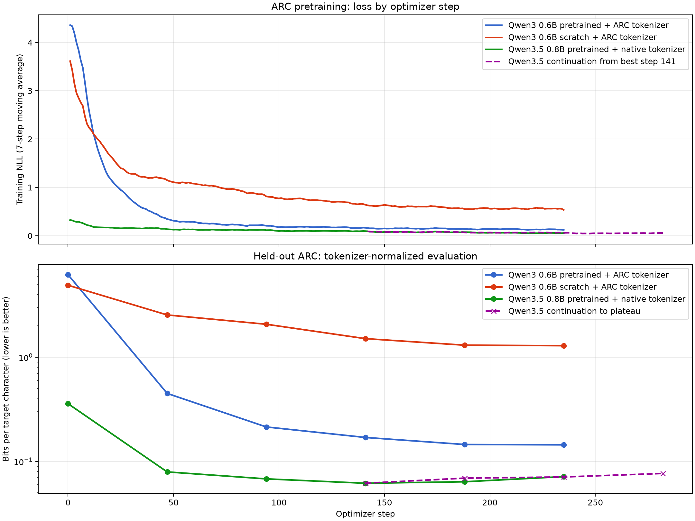

# Comparación de pretraining ARC: Qwen3 y Qwen3.5

Fecha del experimento: 12 de septiembre de 2026  
Hardware: 1 × NVIDIA A100-SXM4-80GB

Seguimiento posterior con Qwen3.5 tokenizer ARC y búsqueda de regularización:
[`qwen_arc_followup_optimization.md`](qwen_arc_followup_optimization.md).



## Conclusión

El mejor punto de partida para RL es **Qwen3.5-0.8B con tokenizer nativo,
checkpoint de la época 3 (optimizer step 141)**. Es el único modelo que
resuelve tareas completas antes de RL (`7/150`), alcanza la mayor cobertura de
pares objetivo (`70.48%`) y obtiene la mejor entropía normalizada entre
tokenizers (`0.06186 bits por carácter objetivo`).

El checkpoint recomendado es:

```text
checkpoints/compare_qwen35_pretrained_native_v3/
```

La extensión desde ese checkpoint no mejoró la evaluación y se detuvo tras
tres épocas consecutivas de degradación. Por tanto, no conviene usar el estado
de la época 5 ni ninguno de los checkpoints de la extensión.

Si se necesita compatibilidad inmediata con el pipeline RL actual, que asume
`ArcCharacterTokenizer`, vocabulario 24 y `Qwen3ForCausalLM`, la segunda mejor
opción es:

```text
checkpoints/compare_qwen3_pretrained_custom_v2.safetensors
```

Ese modelo no alcanza exactos, pero cubre el `53.47%` de los pares. Para usar
el ganador nativo habrá que adaptar el loader, la generación y las recompensas
de RL a `Qwen3_5ForConditionalGeneration` y a spans del tokenizer nativo.

## Protocolo controlado

- Datos de entrenamiento: 1.476 ejemplos admitidos por el límite de 2.816
  caracteres/tokens ARC.
- Augmentation de entrenamiento: original, rotaciones 90/180/270 y dos
  permutaciones independientes de color; hasta seis variantes por tarea antes
  del filtrado.
- Evaluación: las mismas 150 tareas originales en las tres corridas, sin
  rotaciones ni cambios de color.
- Seed: 3407.
- Entrenamiento inicial: 5 épocas y 235 optimizer steps.
- Batch efectivo: 32.
- Objetivo de train: causal cross-entropy sobre prompt y target (`full`).
- Objetivo de eval: causal cross-entropy solo sobre el target dorado.
- Optimizador: fused AdamW, `lr=3e-5`, weight decay `0.01`, warmup 10%, cosine
  decay y clipping de gradiente a 1.0.
- Los rollouts greedy baseline se omitieron porque las cabezas sin adaptar no
  terminaban de forma fiable. Todos los checkpoints finales sí se evaluaron
  generativamente.

Configuraciones físicas:

| Modelo | Parámetros | Microbatch | Acumulación | Batch efectivo | Pico VRAM | Train 5 epochs |
|---|---:|---:|---:|---:|---:|---:|
| Qwen3 pretrained + tokenizer ARC | 440.516.608 | 8 | 4 | 32 | 39.97 GiB | 21.3 min |
| Qwen3 scratch + tokenizer ARC | 440.516.608 | 8 | 4 | 32 | 39.85 GiB | 17.9 min |
| Qwen3.5 pretrained + tokenizer nativo | 852.985.920 | 4 | 8 | 32 | 39.12 GiB | 26.6 min |

Qwen3.5 necesitó gradient checkpointing. Sin él, microbatch 4 agotó los 80 GB
después de crear los estados de Adam. Se instalaron los kernels
`causal-conv1d` y `flash-linear-attention`; las implementaciones de referencia
eran funcionales pero mucho más lentas.

El tercer modelo conserva sin resize el vocabulario nativo de 248.320 entradas,
sus embeddings y su LM head. La `E` terminal de ARC se representa mediante el
EOS nativo, sin añadir tokens al tokenizer. Qwen describe oficialmente esta
variante como un modelo causal con encoder visual, 0.8B parámetros en el modelo
de lenguaje, dimensión 1024 y 24 capas: [model card de
Qwen3.5-0.8B](https://huggingface.co/Qwen/Qwen3.5-0.8B).

## Resultados tras cinco épocas

La NLL por token no se puede comparar directamente cuando cambia el tokenizer.
Por ello, la columna principal entre modelos es bits por carácter objetivo
(BPC). Para el tokenizer ARC, un token equivale a un carácter; para Qwen3.5 se
acumula la NLL nativa y se divide entre el mismo número de caracteres dorados.

| Modelo | Mejor época | Baseline NLL | NLL final | BPC final | Exactos | Pair recall | Longitud media |
|---|---:|---:|---:|---:|---:|---:|---:|
| Qwen3 pretrained + ARC | 5 | 4.292356 | 0.099959 | 0.144210 | 0/150 | 0.534728 | 839.1 |
| Qwen3 scratch + ARC | 5 | 3.400911 | 0.894740 | 1.290837 | 0/150 | 0.013424 | 2816.0 |
| Qwen3.5 pretrained + nativo | 3 | 0.248335 | 0.042877 | **0.061858** | **7/150** | **0.704767** | **453.3** |

La reevaluación final del ganador obtuvo `pair precision=0.660264`: 7.253
pares válidos de 10.985 candidatos, contando también las coordenadas repetidas
en la salida. Cubrió 7.245 de los 10.280 pares objetivo. Esta corrección de
conteo no altera exactos, recall, NLL, BPC ni la selección del checkpoint.

La NLL de evaluación por época fue:

| Época / step | Qwen3 pretrained ARC | Qwen3 scratch ARC | Qwen3.5 native |
|---|---:|---:|---:|
| baseline / 0 | 4.292356 | 3.400911 | 0.248335 |
| 1 / 47 | 0.311674 | 1.764254 | 0.055030 |
| 2 / 94 | 0.148558 | 1.436211 | 0.047161 |
| 3 / 141 | 0.117787 | 1.044994 | **0.042840** |
| 4 / 188 | 0.100824 | 0.904905 | 0.044266 |
| 5 / 235 | 0.100118 | 0.894460 | 0.049567 |

La pequeña diferencia entre la NLL de epoch 3 (`0.042840`) y la recarga final
BF16 (`0.042877`) procede de reevaluar el checkpoint guardado con pesos BF16.

## Continuación hasta meseta

Se retomó el checkpoint ganador de Qwen3.5 epoch 3 con `lr=1e-5`, warmup 5%,
batch efectivo 32 y un máximo de diez épocas. El criterio de parada fue tres
épocas consecutivas sin una mejora absoluta mínima de `0.00025` en eval NLL.

| Punto | Step de rama | Eval NLL | BPC | Resultado |
|---|---:|---:|---:|---|
| Checkpoint inicial | 141 | **0.042877** | **0.061858** | se conserva |
| Extensión epoch 1 | 188 | 0.047947 | 0.069172 | peor |
| Extensión epoch 2 | 235 | 0.049201 | 0.070982 | peor |
| Extensión epoch 3 | 282 | 0.053179 | 0.076721 | peor; early stop |

Aunque la pérdida de entrenamiento siguió bajando (`0.07625 → 0.05093`), la
pérdida held-out empeoró en cada época. Esto es sobreajuste, no falta de
convergencia. El mínimo útil está en el step 141. La extensión tardó 16.0
minutos de entrenamiento antes del early stop.

## Lectura para la fase RL

1. **Usar Qwen3.5 native epoch 3 si se prioriza rendimiento.** Ya produce siete
   recompensas exactas positivas y cubre más del 70% de los pares, de modo que
   la exploración RL parte de una política con señal útil.
2. **No continuar SFT con el schedule ensayado.** La extensión demuestra que
   incluso `lr=1e-5` erosiona generalización mientras mejora train loss.
3. **Conservar una evaluación realmente final separada.** Estas 150 tareas ya
   se usaron repetidamente para selección de epoch; no deben convertirse en la
   única medida después de ajustar RL.
4. **No elegir scratch.** No aprende terminación (longitud media 2.816), apenas
   cubre 1.34% de pares y ofrece muy poca señal de recompensa.
5. **Fallback de ingeniería:** el Qwen3 custom preentrenado es directamente
   compatible con el RL existente y mantiene señal densa de pares, pero parte
   por debajo del checkpoint nativo en todas las métricas generativas útiles.

## Comandos reproducibles

Ejecutar desde la raíz del repositorio con el entorno creado por uv:

```bash
.venv/bin/arc-pretrain-qwen3 \
  --epochs 5 --batch-size 8 --minibatches 4 \
  --eval-examples 150 --num-color-swaps 2 \
  --skip-baseline-greedy-eval \
  --run-name compare_qwen3_pretrained_custom_v2 \
  --log-file logs/compare_qwen3_pretrained_custom_v2.jsonl \
  --output-checkpoint checkpoints/compare_qwen3_pretrained_custom_v2.safetensors

.venv/bin/arc-pretrain-qwen3 \
  --from-scratch --epochs 5 --batch-size 8 --minibatches 4 \
  --eval-examples 150 --num-color-swaps 2 \
  --skip-baseline-greedy-eval \
  --run-name compare_qwen3_scratch_custom \
  --log-file logs/compare_qwen3_scratch_custom.jsonl \
  --output-checkpoint checkpoints/compare_qwen3_scratch_custom.safetensors

.venv/bin/arc-pretrain-qwen35-native \
  --epochs 5 --batch-size 4 --minibatches 8 \
  --gradient-checkpointing \
  --eval-examples 150 --num-color-swaps 2 \
  --skip-baseline-greedy-eval \
  --run-name compare_qwen35_pretrained_native_v3 \
  --log-file logs/compare_qwen35_pretrained_native_v3.jsonl \
  --output-checkpoint checkpoints/compare_qwen35_pretrained_native_v3
```

Continuación usada para comprobar la meseta:

```bash
.venv/bin/arc-pretrain-qwen35-native \
  --model-id checkpoints/compare_qwen35_pretrained_native_v3 \
  --epochs 10 --batch-size 4 --minibatches 8 \
  --gradient-checkpointing --learning-rate 1e-5 --warmup-fraction 0.05 \
  --early-stop-patience 3 --min-eval-improvement 0.00025 \
  --eval-examples 150 --num-color-swaps 2 \
  --skip-baseline-greedy-eval \
  --run-name extend_qwen35_native_to_plateau \
  --log-file logs/extend_qwen35_native_to_plateau.jsonl \
  --output-checkpoint checkpoints/extend_qwen35_native_to_plateau
```

## Artefactos

- Logs JSONL: `logs/compare_qwen3_pretrained_custom_v2.jsonl`,
  `logs/compare_qwen3_scratch_custom.jsonl`,
  `logs/compare_qwen35_pretrained_native_v3.jsonl` y
  `logs/extend_qwen35_native_to_plateau.jsonl`. La comprobación final corregida
  está en `logs/qwen35_best_final_reeval.jsonl`.
- Gráfica reproducible: `scripts/plotting/plot_pretraining_comparison.py`.
- Runner Qwen3.5 nativo: `arc-pretrain-qwen35-native`.
- Checkpoint ganador: `checkpoints/compare_qwen35_pretrained_native_v3/`.
